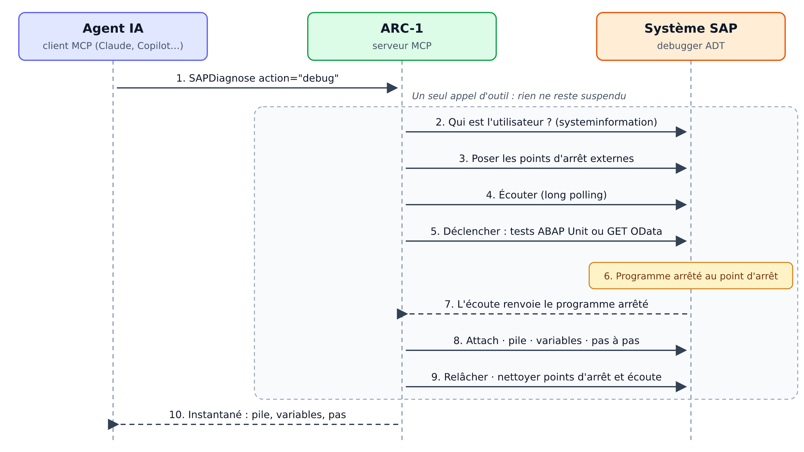

# Déboguer de l'ABAP depuis un agent IA : la capture « one-shot » d'ARC-1

*Donner à Claude, Copilot ou tout autre client MCP le premier réflexe du développeur ABAP face à un bug, poser un point d'arrêt et regarder les valeurs, en un seul appel et sans jamais laisser de programme suspendu.*

Les assistants IA connectés à un système SAP savent déjà beaucoup de choses : lire une classe, chercher un objet, lancer des tests ABAP Unit, analyser un dump, exécuter l'ATC. Mais face à un comportement inattendu, il leur manque l'essentiel : les valeurs au moment de l'exécution. Un développeur ouvrirait le debugger d'Eclipse ; l'agent, lui, relit le code et formule des hypothèses.

Cet article présente une nouvelle fonctionnalité proposée pour ARC-1 : `SAPDiagnose action="debug"`, une capture de debugger ABAP « one-shot ». À quoi elle sert, comment elle fonctionne sous le capot, et ce que nous avons appris en la faisant fonctionner sur SAP BTP ABAP Environment.

> [!NOTE]
> **En bref**
> - Une action d'ARC-1 qui pose un point d'arrêt, déclenche le code, lit les valeurs puis relâche le programme, en **un seul appel d'outil**.
> - Pensée pour les agents IA : rien ne reste suspendu entre deux appels, ni programme arrêté, ni point d'arrêt, ni écoute.
> - Désactivée par défaut et en lecture seule : chacun ne débogue que ses propres exécutions.
> - Proposée dans la pull request n° 1098 d'ARC-1 ; testée pour l'instant uniquement sur SAP BTP ABAP Environment.

## ARC-1 en deux mots

[ARC-1](https://github.com/arc-mcp/arc-1) est un serveur MCP (Model Context Protocol) open source qui donne aux assistants IA (Claude, GitHub Copilot, Cursor, Gemini CLI…) un accès aux ABAP Development Tools (ADT) de SAP. Plutôt que des centaines d'endpoints, il expose une douzaine d'outils « par intention » (`SAPRead`, `SAPWrite`, `SAPActivate`, `SAPDiagnose`…), conçus pour consommer peu de tokens.

Il est pensé comme un service géré : déployé sur SAP BTP Cloud Foundry (XSUAA, Destination Service, principal propagation), en Docker ou en local, avec un plafond de sécurité fixé par l'administrateur. Tout est en lecture seule par défaut, chaque capacité sensible s'active explicitement et chaque appel est audité. Avec la principal propagation, chaque utilisateur MCP travaille sous sa propre identité SAP, avec ses propres autorisations.

## À quoi ça sert

La capture répond à une question simple : **« Quelles sont les valeurs à la ligne N quand ce code s'exécute ? »** Concrètement, un agent peut désormais :

- comprendre un résultat inattendu en observant les variables au bon endroit, plutôt qu'en relisant le code ;
- vérifier une hypothèse avant de proposer une correction, au lieu de corriger à l'aveugle ;
- trouver où une exception est levée, même si elle est attrapée plus loin, grâce à un point d'arrêt sur une classe d'exception ;
- suivre jusqu'à 20 instructions pas à pas pour voir une variable évoluer dans une boucle ;
- déboguer le chemin d'un service OData, par exemple le query provider d'une entité RAP, en déclenchant un simple GET en lecture seule ;
- attraper une exécution lancée par l'utilisateur lui-même, qui ouvre par exemple l'application Fiori pendant que la capture attend.

### Un exemple concret

Prenons une petite classe de démonstration, `ZCL_ARC1_DBG_DEMO`. La méthode `get_total` calcule le montant d'une ligne de commande, avec une remise de 10 % au-delà de 100 ; `summarize` additionne les lignes d'une commande :

```abap
METHOD get_total.
  DATA lv_subtotal TYPE i.
  DATA lv_discount TYPE i.
  lv_subtotal = iv_qty * iv_price.
  IF lv_subtotal > 100.
    lv_discount = lv_subtotal / 10.
  ENDIF.
  rv_total = lv_subtotal - lv_discount.
ENDMETHOD.

METHOD summarize.
  DATA lt_sorted TYPE tt_items.
  lt_sorted = it_items.
  SORT lt_sorted BY price DESCENDING.
  LOOP AT lt_sorted INTO DATA(ls_item).
    rs_summary-lines = rs_summary-lines + 1.
    rs_summary-total = rs_summary-total
                     + get_total( iv_qty = ls_item-quantity iv_price = ls_item-price ).
  ENDLOOP.
ENDMETHOD.
```

On demande à l'agent : « Montre-moi comment `RS_SUMMARY` évolue dans la boucle de `summarize`. » Il appelle l'outil avec un point d'arrêt sur la ligne du cumul (la ligne 59 de la classe), deux variables à lire et quatre pas :

```json
{
  "action": "debug",
  "type": "CLAS",
  "name": "ZCL_ARC1_DBG_DEMO",
  "line": 59,
  "variables": ["LS_ITEM", "RS_SUMMARY"],
  "steps": 4,
  "timeoutSeconds": 30
}
```

Personne n'a besoin de lancer le programme : par défaut, ARC-1 déclenche les tests ABAP Unit de la classe, qui passent par `summarize`. Quelques secondes plus tard, l'agent reçoit ceci (extrait abrégé d'une capture réelle) :

```json
{
  "hit": true,
  "trigger": { "kind": "unittest", "status": "completed",
               "result": { "outcome": "passed", "tests": 3, "passed": 3 } },
  "stoppedAt": { "procedure": "METHOD SUMMARIZE", "line": 59 },
  "stack": [
    { "procedure": "METHOD SUMMARIZE", "line": 59 },
    { "procedure": "METHOD SUMMARY_OF_ITEMS", "line": 27 }
  ],
  "variables": [
    { "name": "LS_ITEM", "kind": "structure",
      "components": { "PRODUCT": "Pen", "QUANTITY": "3", "PRICE": "40" } },
    { "name": "RS_SUMMARY", "kind": "structure",
      "components": { "LINES": "1", "TOTAL": "0" } }
  ],
  "steps": [
    { "step": 1, "line": 60,
      "values": { "RS_SUMMARY": { "LINES": "1", "TOTAL": "108" } } },
    { "step": 2, "line": 57,
      "values": { "RS_SUMMARY": { "LINES": "1", "TOTAL": "108" } } },
    { "step": 3, "line": 58,
      "values": { "LS_ITEM": { "PRODUCT": "Ink", "QUANTITY": "1", "PRICE": "5" } } },
    { "step": 4, "line": 59,
      "values": { "RS_SUMMARY": { "LINES": "2", "TOTAL": "108" } } }
  ],
  "release": { "released": true, "via": "continue" }
}
```

L'agent n'a plus à deviner. Au premier passage, la ligne « Pen » (3 × 40 = 120) fait passer le total de 0 à 108, et non à 120 : la remise de 10 % de `get_total` s'applique ligne par ligne, dès qu'une ligne dépasse 100. Règle métier voulue ou bug ? La discussion repose désormais sur un fait observé. La pile indique au passage que l'exécution venait de la méthode de test `SUMMARY_OF_ITEMS`, et `release` confirme que le programme a été relâché à la fin de la capture.

## Pourquoi un debugger « one-shot »

Le debugger d'Eclipse ADT est interactif : on pose un point d'arrêt, on lance le programme, Eclipse s'attache, puis on inspecte et on avance à son rythme, aussi longtemps qu'il le faut. Ce modèle ne convient pas à un agent IA, pour une raison très concrète : un programme ABAP arrêté dans le debugger occupe un work process, et parfois des verrous, tant qu'il n'est pas relâché. Le laisser suspendu entre deux appels d'outils, c'est le bloquer pendant que le modèle réfléchit… ou indéfiniment si la conversation s'arrête là.

ARC-1 applique donc à la capture le principe qu'il applique déjà à ses verrous d'édition : rien ne survit à un appel d'outil. Une capture fait tout dans un seul appel (armer, déclencher, attraper, lire, avancer de quelques pas si on le demande, relâcher, nettoyer) et renvoie un instantané : la pile, les variables demandées, la trace des pas. Elle ne laisse rien derrière elle, ni programme arrêté, ni point d'arrêt, ni écoute.

## Comment ça marche

Sous le capot, ARC-1 n'utilise que les ressources REST natives du debugger ADT, celles qu'utilise Eclipse, sans aucun code ABAP d'aide à installer sur le système.



Le tableau suivant détaille chaque étape et la ressource ADT correspondante :

| Étape | Ce que fait ARC-1 | Ressource ADT |
|---|---|---|
| Identifier l'utilisateur | Demande à SAP le nom de l'utilisateur de la session. Il n'est jamais fourni par l'appelant. | `/sap/bc/adt/core/http/systeminformation` |
| Poser les points d'arrêt | Points d'arrêt externes pour cet utilisateur : ligne, méthode, méthode de classe de test ou classe d'exception. SAP refuse une ligne sans instruction : ARC-1 essaie alors les lignes suivantes. | `/sap/bc/adt/debugger/breakpoints` |
| Écouter | Vérifie qu'aucun autre debugger (Eclipse, par exemple) n'écoute déjà pour cet utilisateur, puis ouvre une écoute en long polling. | `/sap/bc/adt/debugger/listeners` |
| Déclencher | Lance les tests ABAP Unit de la classe (par défaut), un GET OData en lecture seule (`trigger="http"`), ou attend que l'utilisateur exécute lui-même le code (`trigger="none"`). | `/sap/bc/adt/abapunit/testruns` ou le service OData |
| S'attacher | Le programme s'arrête ; l'écoute renvoie ce « debuggee », et ARC-1 s'y attache depuis une session stateful. | `/sap/bc/adt/debugger?method=attach` |
| Lire | Pile d'appels, variables demandées, structures composant par composant, premières lignes des tables internes. | `?method=getStack`, `getVariables`, `getChildVariables` |
| Avancer (option) | Jusqu'à 20 `stepOver`, en relisant les variables après chaque pas. | `?method=stepOver` |
| Relâcher et nettoyer | Le programme reprend son exécution ; points d'arrêt et écoute sont supprimés, quoi qu'il arrive. | `?method=stepContinue`, puis suppressions |

Quelques détails qui comptent :

- Tout ce qui touche au programme arrêté (attach, lecture, pas, libération) passe par une même session stateful, identifiée par le cookie `sap-contextid`.
- L'écoute et le déclencheur tournent en parallèle : ARC-1 arme l'écoute, laisse à SAP un court instant (1,5 s) pour l'enregistrer, puis lance le déclencheur.
- Si rien ne s'arrête dans le délai (60 s par défaut, 240 s au maximum), la capture le signale avec une piste, par exemple « le test s'est terminé sans passer par la ligne », puis nettoie tout.
- La sortie est bornée pour rester lisible par un modèle : 15 niveaux de pile, 60 variables par niveau, 30 composants par structure, 5 lignes par table interne, 500 caractères par valeur.
- La libération dispose de son propre budget de temps : même si l'inspection a épuisé le sien, le programme est toujours relâché.

## Le cas difficile : plusieurs serveurs d'application

C'est le point qui a demandé le plus d'enquête, et il est instructif.

Sur SAP BTP ABAP Environment, les premiers essais se passaient bien… jusqu'à l'attach. Le point d'arrêt était atteint, l'écoute renvoyait bien le programme arrêté, mais chaque tentative de s'y attacher échouait avec l'erreur `invalidDebuggee` (`CX_ABDBG_ACTEXT_CANNOT_ATTACH`). L'analyse a mis en évidence trois choses :

1. **SAP n'accepte l'attach que depuis le serveur du programme arrêté.** La session qui s'attache doit tourner sur le même serveur d'application que le debuggee (son `INSTANCE_NAME`), même si le système annonce `CAN_ADT_CROSS_SERVER=true`. Pire : une tentative refusée « abîme » le debuggee, et les suivantes échouent aussi.
2. **On peut savoir où tourne une session.** Le cookie `sap-contextid` d'une session stateful contient le nom de son serveur d'application.
3. **Le répartiteur de charge joue contre nous.** Chaque nouvelle session part vers le serveur le moins chargé, et le serveur où un programme est arrêté est justement le plus chargé. Dans nos mesures, les sessions ouvertes après l'arrêt évitaient ce serveur à chaque fois (16 sur 16).

D'où la solution : inverser l'ordre. Avant de lancer le déclencheur, ARC-1 ouvre des sessions stateful jusqu'à en obtenir deux sur le même serveur. Il lance les tests unitaires depuis l'une et garde l'autre prête pour l'attach : le programme s'arrête forcément sur un serveur où une session l'attend déjà. Pour les autres déclencheurs, ou si cela ne suffit pas, ARC-1 sonde un nombre limité de nouvelles sessions pour retrouver le bon serveur, traite `invalidDebuggee` comme un échec définitif plutôt que de réessayer à l'aveugle, et ferme chaque session inutilisée avec la même requête de fermeture qu'Eclipse.

Autre particularité : sur BTP, les serveurs d'application sont des pods dont le nom change au fil du temps. ARC-1 les découvre donc au moment de l'exécution, sans aucune configuration. Sur un système à un seul serveur d'application, comme beaucoup de bacs à sable on-premise, rien de tout cela n'est visible : c'est précisément pour ce genre de surprise qu'un test sur un environnement réel compte.

## Sécurité et gouvernance

Lire des variables, c'est lire des données métier. La fonctionnalité suit donc le modèle de sécurité d'ARC-1 :

- **Désactivée par défaut.** Il faut activer `SAP_ALLOW_DEBUG` **et** `SAP_ALLOW_DATA_PREVIEW`, et l'utilisateur doit disposer du scope `data`. Tant que ces deux options ne sont pas activées, l'action n'apparaît même pas dans la liste des outils.
- **Chacun ne débogue que lui-même.** L'utilisateur débogué est celui de la session, nommé par SAP ; ce n'est jamais un paramètre. Avec la principal propagation, chaque utilisateur MCP ne peut attraper que ses propres exécutions.
- **Lecture seule.** Pas de modification de variable, pas de saut d'instruction, pas de debug système.
- **Bornée.** Attente de 1 à 240 secondes (60 par défaut), 20 variables et 20 pas au maximum, budgets de temps séparés pour l'inspection et la libération, et un nombre de captures simultanées limité au quart de `ARC1_MAX_CONCURRENT` (au moins une).
- **Auditée**, comme tout appel d'outil ARC-1.
- **Un risque résiduel documenté.** Si tous les utilisateurs MCP partagent un même utilisateur SAP technique, une capture peut attraper l'exécution d'un autre utilisateur MCP. Dans ce type de déploiement, mieux vaut laisser la fonctionnalité désactivée.

## Ce que les tests nous ont appris

- **Une latence après activation.** Juste après l'activation de code modifié, des points d'arrêt posés dessus ne se déclenchaient pas pendant environ 75 secondes, alors que les tests s'exécutaient bien. Hypothèse, non vérifiée : la nouvelle version atteint l'autre serveur d'application avec retard (synchronisation des buffers). La capture conseille simplement d'attendre une minute.
- **UCON et services fraîchement publiés.** Un service OData V4 tout juste publié répondait 403 (« blocked by UCON ») pendant quelques minutes, puis fonctionnait normalement. La capture signale alors un déclencheur en échec, avec une explication.
- **Un seul debugger externe par utilisateur.** Si Eclipse écoute déjà pour le même utilisateur, SAP refuse une seconde écoute : ARC-1 renvoie le message de conflit sans rien armer.

## Où en est le projet

> [!WARNING]
> **Testée uniquement sur SAP BTP ABAP Environment.** La fonctionnalité n'a pas encore été testée sur SAP S/4HANA on-premise, S/4HANA Cloud Private Edition ni S/4HANA Cloud Public Edition. Ces tests restent à faire avant de s'y fier sur ces systèmes.

- La fonctionnalité est proposée au projet ARC-1 dans la [pull request n° 1098](https://github.com/arc-mcp/arc-1/pull/1098), en attente de relecture par les mainteneurs. Elle ne fait donc pas encore partie d'une version publiée, et sa forme peut encore évoluer.
- Les tests en conditions réelles ont été menés sur SAP BTP ABAP Environment (trial, SAP_BASIS 920, deux serveurs d'application), avec principal propagation et claude.ai comme client MCP : points d'arrêt sur ligne, méthode, méthode de test et classe d'exception, structures et tables internes, pas à pas, déclenchement HTTP, expiration du délai et conflit avec Eclipse.
- Côté automatisé, la suite de tests d'ARC-1 (plus de 10 000 tests unitaires) passe, y compris les nouveaux tests du debugger et de son routage multi-serveurs.

## Conclusion

Pour un développeur ABAP, le debugger est souvent le premier réflexe face à un comportement inattendu. Avec cette capture, un agent IA passe de « lire et supposer » à « observer » : il pose un point d'arrêt, lit les valeurs et appuie son diagnostic sur des faits, en un seul appel, sans jamais laisser de programme suspendu sur le système.

Les contraintes qui ont façonné la conception (rien qui survive à un appel, l'identité de l'utilisateur, la lecture seule, des limites partout) sont aussi celles qui rendent la fonctionnalité acceptable dans un système SAP d'entreprise.

Pour aller plus loin : le dépôt [ARC-1 sur GitHub](https://github.com/arc-mcp/arc-1) et la [pull request n° 1098](https://github.com/arc-mcp/arc-1/pull/1098).
